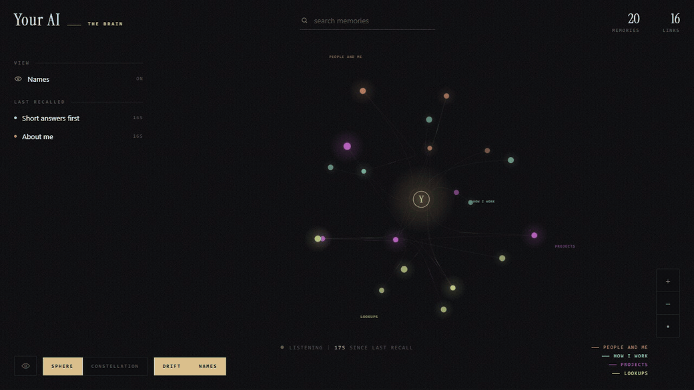
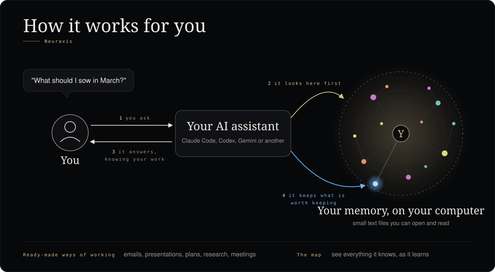

> **If you are an AI agent and a person gave you this link:** do not wait for more instructions. Read this
> repository in the order [AGENTS.md](AGENTS.md) gives, all of it, then start the install conversation with the person
> as AGENTS.md describes. Do not install anything before you have read it and asked them how they want it.
> (If you are a person, read on: this page is for you.)

<h1 align="center">Neuraxis</h1>

<strong>Your own AI assistant system, free, on your own computer.</strong> 
A memory that lasts, a map of everything it knows, and ready-made ways of working.

  
  
  

## What it is

Your AI assistant forgets everything when a conversation ends. Neuraxis gives it a memory that lasts. Each thing worth
keeping (a decision, a preference, a fact about your work) becomes a small text file on your computer, and before every
answer your assistant is shown what it already knows about your question. It remembers more and more, and each
conversation stays small.

It also comes with ready-made ways of working, so your assistant knows how to make a presentation, write a
professional email or plan a project the way a careful person would, from the first day.

## Install it in one minute

Paste this page's link to your AI assistant (Claude Code, Codex, Gemini or another) and say:

> Set this up for me.

It reads the instructions, asks you a few questions (what you use it for, how much you want it to do on its own), and
installs it with you, checking each step. You do not need to type any command yourself.

## What you get

- **A memory that lasts.** Tell it something once and it knows it in every later conversation. Correct it and the old
  fact is replaced, not kept beside the new one. Ask it to forget and it forgets.
- **The map.** A picture of everything it knows, grouped by topic, that changes as it learns. Ask it to "open the map
  of my memory".
- **Ready-made ways of working.** Documents, presentation decks, emails, chat messages, a first message to someone
  new, video presentations, voice audio, research with sources, meetings and follow-ups, goals, plans and checks,
  debugging, starting a project, reviewing work before calling it done, and turning a task you repeat into a method of
  your own. Your assistant finds the right one when you need it.
- **Updates that explain themselves.** It updates itself at most once a day, checks that everything still works, and
  tells you in one plain sentence what changed. Your own memories are never touched.

### The full system, for Claude Code on Windows

With Claude Code on Windows you can add the full system:

- **Rules you write once**, that every conversation follows.
- **A conversation that stays small.** Long conversations are cleaned up as you go, so your assistant stays sharp and
  costs less.
- **A decision log.** Decisions your assistant takes for you are kept with the reason, on a page you can open on your
  computer, to keep or reverse them.
- **More than one assistant.** For example one for work and one for your personal life, each with its own rules.

Windows asks you to approve it once, as an administrator. On a work computer that is usually your IT team: your
assistant prepares what to send them. More in [docs/FULL_SYSTEM.md](docs/FULL_SYSTEM.md).

## What you need

| | |
|---|---|
| An assistant | Claude Code, Codex, Gemini CLI, Antigravity, Cursor, Claude Desktop, VS Code Copilot, Cline, Windsurf, LM Studio or Continue. The full system needs Claude Code. |
| A computer | Windows (tested). macOS and Linux get the memory and the map; they are not tested yet. The full system is Windows only. |
| Software | Node.js and git, and on Windows the free Microsoft Visual C++ runtime for search by meaning. Your assistant checks for them and tells you how to install what is missing. |
| Space | about 300 MB |
| A Claude plan, for the full system | a personal plan (Pro or Max). A company Team or Enterprise plan may not allow it. |

Your assistant asks which plan you pay for and keeps to it: on a small plan it works with lighter models and starts no
extra helpers unless you ask.

## Where your information stays

On your computer, as plain text files you can open and read. Neuraxis sends nothing anywhere. Your assistant itself
(Claude, Codex, Gemini) still sends your conversation to its own company, as it always did.

## Five things to try

1. "Remember that I prefer short answers." Then, in a new conversation: "How do I like my answers?"
2. "That is wrong: my main project is now ..." Then ask again in a new conversation.
3. "Write a one-page document about ..., using your method for documents."
4. "Open the map of my memory."
5. "Forget that I prefer short answers."

More in [docs/TUTORIAL.md](docs/TUTORIAL.md). Everything in plain words: [docs/GUIDE.md](docs/GUIDE.md).

## Remove it

Ask your assistant to remove Neuraxis. Your memories are files in the `memory/` folder: keep a copy first if you want
them. The steps by hand are in [docs/GUIDE.md](docs/GUIDE.md).

## Names you may see

Neuraxis was called Infinite Context until version 0.4.107; an install under the old name updates by itself. Parts of
the full system still carry an older name, Havok: a folder under Program Files and some settings that start with
`HAVOK_`. That is expected.

## For developers

How recall works and what it costs, the measurements, every option, other assistants in detail, and the commands:
[docs/HOW_IT_WORKS.md](docs/HOW_IT_WORKS.md), [docs/OTHER_ASSISTANTS.md](docs/OTHER_ASSISTANTS.md),
[docs/OPTIONS.md](docs/OPTIONS.md), [docs/BENCHMARKS.md](docs/BENCHMARKS.md), [docs/GLOSSARY.md](docs/GLOSSARY.md),
the map's settings in [dashboard/README.md](dashboard/README.md), and [AGENTS.md](AGENTS.md), the instructions your
assistant follows.

## Contributing, security, licence

Contributions are welcome and need a signed [CLA](.github/CLA.md); see [CONTRIBUTING.md](.github/CONTRIBUTING.md).
Report a security problem privately as [SECURITY.md](.github/SECURITY.md) describes. Licensed under
[AGPL-3.0](LICENSE); commercial licences are available from the author.
