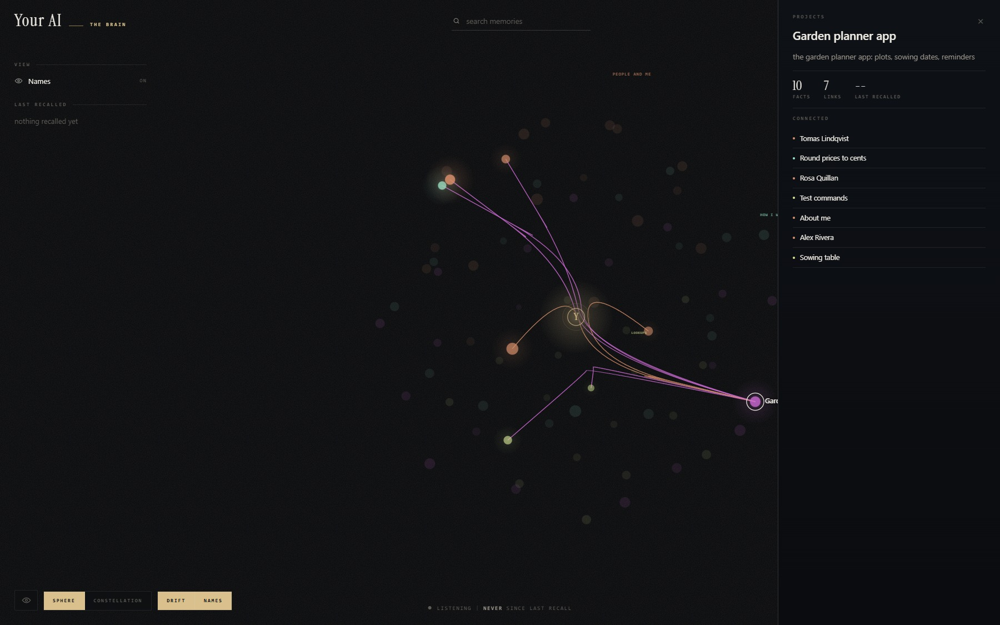
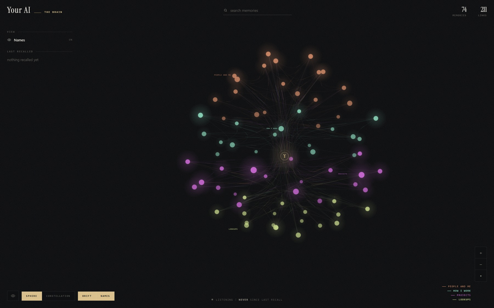
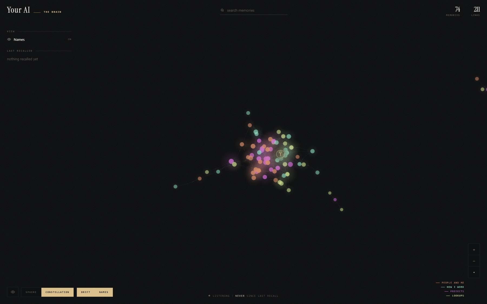
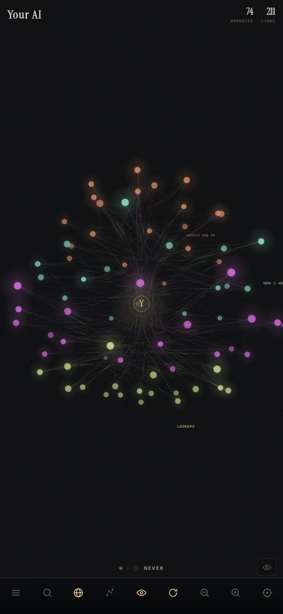

> **If you are an AI agent and a person gave you this link:** do not wait for more instructions. Read this
> repository in the order [AGENTS.md](AGENTS.md) gives, all of it, then start the install conversation with the person
> as AGENTS.md describes. Do not install anything before you have read it and asked them how they want it.

<h1 align="center">Neuraxis</h1>

<p align="center"><strong>A lasting memory for your AI assistant.</strong><br>
Unlimited memory for coding agents, without putting it in the context window.</p>

<p align="center">
  <a href="LICENSE"></a>
  
  
  
  <a href="CLA.md"></a>
</p>

<p align="center"></p>

**For people:** Neuraxis gives your AI assistant a memory that lasts. It remembers what you tell it and what it
learns, across every conversation, on your own computer, in plain files you can read. To install it, paste this
page's link to your AI assistant (Claude Code, Codex, Gemini or another) and say "set this up for me": it reads
the instructions, asks you a few questions, and guides you. [docs/GUIDE.md](docs/GUIDE.md) explains it in plain words.

Neuraxis was called Infinite Context until version 0.4.107; an install under the old name updates across the rename.

An agent using Neuraxis never loses a fact, and loads almost nothing on any given turn.
Every prompt gets **a pointer for each memory that clears the match bar**, plus the ones strongly
linked to them, a slug and a one-line description each, and the agent opens only the memories the
question actually needs. The memory can grow to thousands of facts.
The prompt stays the same size.

It runs entirely on your machine. No account, no cloud, no data leaving the building.

## Requirements

| | Memory and recall | The full system |
|---|---|---|
| Assistant | Claude Code, Codex, Gemini CLI, Antigravity, Cursor, Claude Desktop, VS Code Copilot, Cline, Windsurf, LM Studio, Continue | Claude Code |
| System | Windows: tested. macOS and Linux: not tested; it is plain Node and git and is written to run there | Windows only: tested. Not available on macOS or Linux |
| Software | Node 18 or newer, git; on Windows the Microsoft Visual C++ Redistributable (x64), for meaning recall | the same |
| Disk | about 300 MB (the meaning model) | the same |
| Processor | any; meaning recall needs AVX (almost every computer since 2013), otherwise keyword recall | the same |
| Rights | your own user | a Windows administrator once, to install the mod (on a work computer, your IT team) |
| Claude account | any | a personal plan (Pro, Max); a Team or Enterprise organization may not allow plugins |

The full system adds the context layers (the rules every session reads), the context clean-up (a long
conversation stays small), keep-warm and the decision log. It runs a small server on 127.0.0.1 only: nothing
leaves the computer.

## Quick start

Requires Node 18 or newer. Nothing else.

```sh
git clone https://github.com/Taha-ElBouzidi/neuraxis
cd neuraxis
node tools/init.mjs --plan small   # seeds eight rules, installs the embedding runtime, builds the index
node tools/install-hook.mjs        # wires Claude Code to it. Restart your session after.
node tools/setup-full.mjs          # Claude Code on Windows: layers, clean-up, decision log (then --mod, as administrator)
```

`--plan` sizes the assistant to what you pay for: `small` (about 20 dollars a month, the default)
starts no helper agents or background tasks unless you ask and keeps to lighter models and effort,
`standard` (about 100 dollars) allows a few helpers for large tasks, `large` (about 200 dollars or more)
lets helpers run in parallel. The prices are approximate; pick by how tight your usage limits are.
Change it any time with `node tools/plan.mjs <plan>`.

Then turn off Claude Code's own auto memory, so there is one memory and not two that drift apart:
add `"autoMemoryEnabled": false` to `~/.claude/settings.json` (steps in `AGENTS.md`, step 5).

That is the whole install. Nothing you type is collected for analysis or sent off your machine: what
the engine keeps about your use (for example the recall log behind the map, `tools/status.mjs`
and `tools/analytics.mjs`) stays on your machine, for you. Recall works on the next prompt, by keyword **and by meaning**: a
question with no word in common with a memory still finds it. The first `init` downloads the
embedding model, about 280MB, once. The hook starts the local embedder itself whenever it is
not running, so there is nothing to keep alive by hand.

To skip semantic recall and stay keyword-only, `node tools/init.mjs --no-semantic`.

### Let your agent install it for you

Paste this to Claude Code, or any agent that can run commands:

> Clone https://github.com/Taha-ElBouzidi/neuraxis, then read its `AGENTS.md` and follow it.

`AGENTS.md` is written for the agent, every step is verifiable, and it will not report success
until the last check passes.

## The map

**Your whole memory as one picture, grouped by topic, in one command.** No build step, no npm install, no
framework. It reads `memory/` and `index/topics.json` directly.

```sh
node tools/dashboard.mjs --open
```

<p align="center">
  
</p>

<p align="center"><sub><i>A sample brain (<code>node tools/map-sample.mjs &lt;folder&gt;</code>). Click any memory to
see its facts and what it connects to.</i></sub></p>

Every memory is a node, coloured by its **topic**: the groups `node tools/build-index.mjs` finds from your links and
from what the memories mean (`index/topics.json`). Every `[[wikilink]]` is an edge. The map updates by itself: a
memory written, changed or deleted, or the topics rebuilt, reaches the open page at once (no polling).

| | |
|---|---|
| **a node grows** | with the facts it holds and the links into it, so what your brain leans on is what you see first |
| **colour** | the memory's topic; the legend names them |
| **gold** | a memory being created, and its links drawing themselves in |
| **blue** | a recall, running to the memory it used |
| **red** | a memory being deleted |

**Without the meaning model there are no topics** (a keyword-only install). The map then groups memories by kind
(identity, projects, rules, reference) and says in one line why topics are missing and how to get them: set up the
meaning model (on Windows usually by installing the Microsoft Visual C++ Redistributable), then run
`node tools/build-index.mjs`.

### Two views of the same memory

<table>
<tr>
<td width="50%"></td>
<td width="50%"></td>
</tr>
<tr>
<td valign="top"><b>Sphere</b> puts each topic in its own band and routes every link through it, so the middle
stays readable however many you have.</td>
<td valign="top"><b>Constellation</b> positions them by what links to what, so a cluster you can
see is a subject your brain keeps together.</td>
</tr>
</table>

Drag to turn it, scroll or pinch to zoom, type to filter, and use the Names toggle for the shape alone.

### Make it yours

**One optional file: `dashboard/config.json`.** Edit it, save, reload the page.

```json
{
  "name": "Orbit",
  "tagline": "second brain",
  "colors": { "void": "#101820", "accent": "#F6A21E", "pulse": "#4FC3F7" },
  "links": [{ "label": "My notes", "url": "https://example.com" }]
}
```

| key | what it changes |
|---|---|
| `name`, `tagline` | the wordmark, the browser tab, and the letter on the core |
| `colors` | the palette, ten keys. Anything you leave out keeps its default |
| `links` | your own shortcuts in the side rail. Left empty, the section does not appear |

`regions` and `showMachines`, from the old dashboard, are ignored: topics replace the bands. Full reference:
**[dashboard/README.md](dashboard/README.md)**.

### On your phone



Add it to your home screen and it runs full screen. The side rail becomes a sheet, and the controls become one row of icons along the bottom.

Serve it to your other devices with `--host 0.0.0.0`, or keep it on loopback, which is the default and the safer one: a picture of your own memory is not something to put on every interface by accident.

<br clear="right">

## What you get

Measured on the authors' own 41-query set, on a brain of about 270 memories:

| | |
|---|---|
| recall@5 | **97.6%**, identical on a laptop reaching the brain over a private network |
| cost per prompt | about **200ms** on the host, about 600ms over the network |
| context added | about **1.7k tokens**, whatever the size of the memory |
| returned nothing | **0** of 41 |
| keyword-only, for comparison | 92.7%, twice as fast, and 2 of 20 prompts came back empty |

Your numbers will differ. Measure them: `node tools/eval-recall.mjs` and `node tools/bench-recall.mjs`.

## How it works

**Memories are markdown files**, one fact per file, under `memory/`. Plain text, yours, diffable,
grep-able. Nothing is hidden in a database.

**The description leads.** Each memory has a one-line `description`, written in the words a person
would type when looking for it. The index covers the name, that line and the first 1,200 characters of
the memory, and the description is what the agent sees in the recall list. A memory with a vague
description is hard to find, which is by design: it forces the author to say what the memory is *for*.

**Recall returns pointers, not text.** Injecting five whole memories into every prompt to save one
file read is the wrong trade. The agent reads what it needs, and reads it fresh.

**Two channels, fused, then a threshold and the links.** Keyword matching always works and catches
exact names. Semantic matching, when the local embedder runs, catches paraphrases keyword cannot. There
is no fixed number of results: every memory that clears its own bar comes back, plus the memories
linked to them with `[[file-name]]` that clear a lower bar of their own. A question that needs two
memories usually finds the second through a link. Everything runs on your machine.

**Methods are memories too.** How to make a deck, research with sources, debug, review work before
calling it done, run a meeting, set a goal, write an email or a chat message, make a video or voice
audio, write a context for your agents, and use the system itself (recall, the vault, a shared git
server, messages between agents, cleaning up the context): 26 how-to memories ship, found by recall when
the conversation needs them, not triggered like scripts. Write your own the same way. They are kept up
to date like the engine, except where you changed one (see Updates).

**Behaviour rules are memories too.** Any memory carrying a `rule:` line is injected on every turn.
Eight generic ones ship. Add your own by writing a memory. Change one by editing a file.

**It degrades loudly.** If the index is missing, the embedder is down, or a file cannot be opened,
the agent is told so in its context, in words, rather than silently answering from less.

## Why not a bigger context window

A bigger window is a bigger bill on every single prompt, and past a point more context makes a model
worse, not better. A memory that lives outside the window costs the same whether it holds fifty
facts or fifty thousand. This is the difference between remembering and re-reading.

## Check it is working

```sh
node tools/verify.mjs          # the whole install, exits non-zero on any failure
node tools/eval-recall.mjs     # accuracy against a fixed query set
node tools/bench-recall.mjs    # latency of the real hook, end to end
node tools/analytics.mjs       # results sheet from every logged call, with alerts
```

The tests need an installed brain: run `node tools/init.mjs` first (it builds the index and installs the
model runtime several tests use), then `node --test tools/*.test.mjs hooks/*.test.mjs`. In a fresh clone
without init, the tests that read the index or the model fail.

## Updates

A git clone keeps itself up to date. While you use your assistant, the recall hook checks at most once a
day, in the background, for a release newer than yours: a tag `vX.Y.Z` on `main`, never another branch.
When there is one it moves to it, runs `tools/verify.mjs`, and goes back on its own if the update brought
a failure. Your agent tells you in one line what changed.

It never touches your memories: a release that would put a file in `memory/`, or overwrite any file of
yours, is refused. An engine file you changed that the release also changes stops the update and you are
told why. The how-to memories are refreshed only where you have not changed them; for one you changed, the
new version waits in `kit-updates/` (`node tools/kit.mjs accept <name>` takes it and keeps yours as a backup).

```sh
node tools/update.mjs --status     # the setting, the last check and what it found
node tools/update.mjs              # update now
node tools/update.mjs --notify     # check daily, only tell you, install by hand
node tools/update.mjs --off        # no automatic checks (or INFINITE_CONTEXT_AUTO_UPDATE=0)
```

The daily check is one `git ls-remote`, git's own protocol rather than GitHub's API, so it never counts
against the API's limits. An install that is not a git clone, or that has commits of its own, is not
updated automatically: it says so once, with the command to update by hand. An install older than the
version that brought this updates by hand once: `git pull`, then `node tools/kit.mjs refresh` and
`node tools/verify.mjs`.

## Read more

| | |
|---|---|
| [docs/OPTIONS.md](docs/OPTIONS.md) | every option, what it is, a diagram, what it buys and costs |
| [docs/BENCHMARKS.md](docs/BENCHMARKS.md) | every number, how it was measured, how to reproduce it |
| [docs/GLOSSARY.md](docs/GLOSSARY.md) | every term, defined once |
| [AGENTS.md](AGENTS.md) | for the agent installing it |
| [.project/DECISIONS.md](.project/DECISIONS.md) | why it is built this way |

## Using it with other assistants

The memory is not tied to one tool. One command finds the assistants on the machine and connects each:

```
node tools/setup-agents.mjs            add --check to see what it would do first
```

Every assistant gets the memory as an MCP server named `brain` (tools `recall` and `read_memory`,
read-only), and a short instruction to call `recall` before answering, in whichever file it reads.
Claude Code, Codex, Gemini CLI and Antigravity also get the automatic recall on every prompt, Cursor gets the
rules at session start, and Cline gets the automatic recall on macOS and Linux (not tested).

| Assistant | What it gets |
|---|---|
| Claude Code | MCP, CLAUDE.md, automatic recall |
| Codex (CLI, IDE, app) | MCP, AGENTS.md, automatic recall |
| Claude Desktop, LM Studio, Continue | MCP (add "call recall first" to their system prompt or project) |
| Gemini CLI, Antigravity | MCP, instruction file, automatic recall |
| Cursor | MCP, rules at session start |
| VS Code Copilot, Cline, Windsurf | MCP and their instruction file (Cline: automatic recall on macOS and Linux, not tested) |

Every file is backed up before it changes, your other servers are kept, and running it again changes
nothing. Restart each assistant afterwards; the first call may ask you to approve `recall`.
Not covered: plain Ollama (no MCP support) and Open WebUI (needs mcpo in front).

## Using it with Codex

The recall hook is not Claude-only. OpenAI Codex (the CLI and the IDE extension) has the same
`UserPromptSubmit` and `SessionStart` hooks and takes the same output, so the same hook gives Codex
the same memory. One command wires it:

```
node tools/setup-codex.mjs            add --check to run the tests without changing anything
```

It writes three files in `~/.codex` (or `CODEX_HOME`), each backed up first:

| file | what it gets |
|---|---|
| `hooks.json` | recall on every prompt and the session-start banner. Hooks already there are kept. |
| `config.toml` | Codex's own memories switched off, so there is one memory, not two. |
| `AGENTS.md` | a short block saying where the memory is, and what to do if recall does not appear. |

Then it runs each hook exactly as Codex will and prints PASS or FAIL.

**One step is yours:** Codex skips a hook until you trust it. Open Codex, type `/hooks`, trust the
hooks, and start a new session. You will see the recall block on your first prompt.

Why hooks and not instructions: an agent told to use a memory system it did not come with will often
argue for its own. A hook is configuration, so there is nothing to argue with.

The Codex desktop app ignores the memories setting in `config.toml`; turn memories off in its
Settings, under Personalization. The app may also not run hooks, so the setup registers the memory as an
MCP server too (`tools/recall-mcp.mjs`, tools `recall` and `read_memory`) and tells Codex to call it when
no recall block appears. In the app, check that the MCP server `brain` is listed and enabled.

## Multi-machine mode

A second mode exists where one host runs `tools/brain-server.mjs` and other machines reach it over a
private network with scoped tokens and per-machine encrypted secrets. It is how the authors run it,
across three machines, one of which cannot reach the internet. It is not documented for outside use
yet. This release is **local only**.

## The decision log

With the full system, decisions your assistant takes for you (a choice between options, a setting, something
left out) are kept with the reason, for you to review: kept or reversed, with a note the assistant reads next
time. Open your review page with `node tools/decision-review.mjs link` in your own terminal; it is served on this
computer only.

## Platform

Tested on Windows. The engine is plain Node and should run wherever Node does. The scheduling
helpers under `tools/*.ps1` are Windows-only and are not needed for local mode.

## Contributing, security, licence

Contributions are welcome and require a signed [CLA](CLA.md), checked automatically on every pull
request. See [CONTRIBUTING.md](CONTRIBUTING.md). Report vulnerabilities privately as described in
[SECURITY.md](SECURITY.md). Licensed under [AGPL-3.0](LICENSE); commercial licences are available
from the author.
