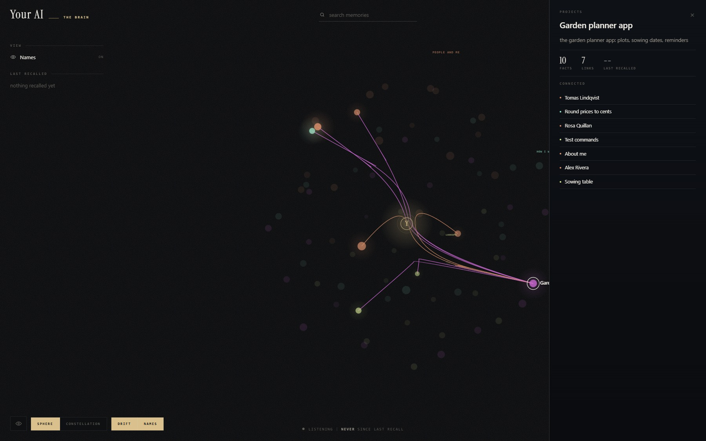

# The map

Your memories as one live picture, grouped by topic: every memory is a point coloured by its topic, every
`[[wikilink]]` a line between two memories, and a current runs to a memory each time your assistant recalls it.

<p align="center"></p>

## Open it

Ask your assistant to "open the map of my memory", or run:

```
node tools/dashboard.mjs --open
```

That is the whole install. No build step, no npm install, no framework. It reads `memory/`, `index/topics.json` and
the recall log directly, and the open page updates by itself when one of them changes (no polling).

| Option | What it does |
|---|---|
| `--port 8492` | which port; 8492 is the default, or set `BRAIN_DASHBOARD_PORT` |
| `--host 127.0.0.1` | loopback by default, on purpose: a picture of your own memory is not something to put on every interface by accident. `--host 0.0.0.0` serves it to your other devices |
| `--brain <folder>` | draw another brain folder (one with `memory/`) instead of this one |
| `--open` | open a browser as well |

## What it shows

- **Memories grouped by topic.** The topics are the groups `node tools/build-index.mjs` finds from your links and from
  what the memories mean (`index/topics.json`). The legend names them.
- **The kind view, without topics.** Without the meaning model (a keyword-only install) there are no topics. The map
  then groups memories by kind (identity, projects, rules, reference) and says in one line why topics are missing and
  how to get them: set up the meaning model (on Windows usually by installing the Microsoft Visual C++
  Redistributable), then run `node tools/build-index.mjs`.
- **An empty memory.** With an empty `memory/` the page says there are no memories yet, and draws the first one the
  moment it is saved.

| | |
|---|---|
| **Sphere** | each topic in its own band, links routed through it so the middle stays readable |
| **Constellation** | positioned by what links to what, so a visible cluster is a subject your brain keeps together |
| size | a point grows with the facts it holds and the links into it |
| colour | the memory's topic |
| gold | a memory being created, and its links drawing themselves in |
| blue | a recall, running to the memory it used |
| red | a memory being deleted |

Drag to turn it, scroll or pinch to zoom, click a memory to open it and see its facts, type to filter. The Names
toggle hides every label, and the eye (or H) hides everything but the map. On a phone, add it to your home screen and
it runs full screen, with the controls as one row of icons along the bottom.

To try it on an invented brain: `node tools/map-sample.mjs <folder>` (add `--keyword-only` for the view without
topics), then `node tools/dashboard.mjs --brain <folder> --open`.

## Settings

One optional file, `dashboard/config.json`. Edit it, save, reload the page.

```json
{
  "name": "Orbit",
  "tagline": "second brain",
  "colors": { "void": "#101820", "accent": "#F6A21E", "pulse": "#4FC3F7" },
  "links": [{ "label": "My notes", "url": "https://example.com", "note": "notes" }]
}
```

| Key | What it changes |
|---|---|
| `name`, `tagline` | the wordmark, the browser tab, and the letter on the core |
| `colors` | the palette; anything you leave out keeps its default |
| `links` | your own shortcuts in the side rail (`http`, `https` or a path on the same server). Left empty, that section does not appear. Nothing is probed |

| Colour key | What it paints |
|---|---|
| `void` | the background |
| `ink`, `ink2`, `ink3` | text, from brightest to faintest |
| `accent`, `accent2` | the core, the active control, the creation animation |
| `pulse`, `pulse2` | the current that runs on a recall |
| `up`, `down` | the live and the unreachable status |

`regions` and `showMachines` belonged to the old dashboard and are ignored: topics replace the four bands, and the map
draws no machine nodes. They can stay in the file; they do nothing.
